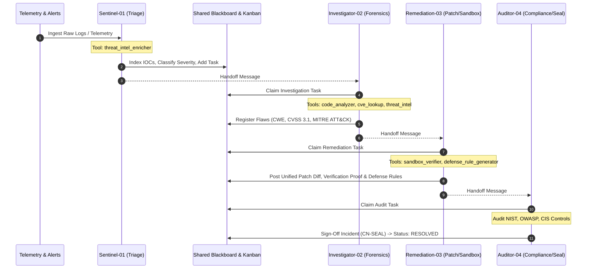

# Cyber-Nova: Autonomous Multi-Agent Cybersecurity Mesh

[](https://www.python.org/downloads/)
[](#architecture)
[](#testing)
[](LICENSE)

**Cyber-Nova** is an autonomous cybersecurity operations platform where specialized AI agents collaborate across the security incident lifecycle to **detect**, **investigate**, **remediate**, **verify in sandbox**, and **audit** vulnerabilities in real time.

Instead of passive conversational chatting, Cyber-Nova agents actively execute real-world tools, coordinate via an event-driven blackboard and collaborative Kanban task board, and produce concrete verified deliverables: code patches with mathematical exploit mitigation proof, perimeter defense rules (ModSecurity WAF, YARA, Sigma), and cryptographically signed executive post-mortems.

---

## Architecture Overview

Cyber-Nova employs an asynchronous, event-driven blackboard pattern where four specialized agents communicate, assign dependencies, and mutate shared incident state:



---

## Cooperating Specialist Agents

| Agent | Role | Responsibilities | Dedicated Tools |
|---|---|---|---|
| 🛡️ **Sentinel-01** | Recon & Ingestion Sentinel | Ingests telemetry streams, parses raw web/cloud/system logs, extracts Indicators of Compromise (IOCs: IPs, CVEs, attack patterns), sets incident severity, seeds triage tasks. | `threat_intel_enricher` |
| 🔍 **Investigator-02** | Forensic & AST Investigator | Audits source code via AST analysis, traces vulnerable variable dataflows, queries CVE databases, computes CVSS 3.1 base score vectors, maps tactics to MITRE ATT&CK. | `code_analyzer`<br>`cve_database_lookup`<br>`threat_intel_enricher` |
| 🔧 **Remediation-03** | Patch & Verification Engineer | Synthesizes surgical security patches, executes automated exploit neutralization tests and regression suites in an isolated sandbox, generates defense-in-depth rules. | `sandbox_verifier`<br>`defense_rule_generator` |
| 📊 **Auditor-04** | Compliance Auditor & Signer | Audits resolution against NIST SP 800-61r2, OWASP Top 10, CIS Controls v8, drafts executive summaries and technical post-mortems, signs off case with cryptographic seal. | `audit_signer` |

---

## Real-World Tools Invoked by Agents

1. **`code_analyzer`**: Python AST parser and semantic pattern recognition engine identifying SQL injection, OS command injection, Path Traversal, SSRF, hardcoded secrets, and insecure deserialization down to exact line numbers and AST nodes.
2. **`cve_database_lookup`**: Queryable vulnerability database with standard FIRST CVSS v3.1 formula vector calculator (Attack Vector, Complexity, Privileges Required, Impact, Exploitability).
3. **`threat_intel_enricher`**: MITRE ATT&CK Enterprise Matrix mapper (T1190, T1059, T1552, T1041) and heuristic reputation scorer for IPs, domains, and attack signatures.
4. **`sandbox_verifier`**: Automated sandbox test harness runner executing real exploit reproduction simulations on baseline vs. patched code, verifying exploit neutralization and 100% functional regression pass.
5. **`defense_rule_generator`**: Synthesizes production defense-in-depth rules:
   - **ModSecurity WAF**: `SecRule` virtual patches for immediate edge blocking.
   - **YARA Signature**: Multi-pattern endpoint scanning rule for webshells and payloads.
   - **Sigma SIEM Rule**: Production YAML detection rule for Splunk, Elastic, and Microsoft Sentinel.

---

## Tangible Preset Incident Scenarios

Cyber-Nova ships with 4 real-world threat scenarios ready to run out of the box:

- **Scenario 1: Critical SQL Injection in Customer Portal API (CVE-2024-28987)**
  - *Telemetry*: Nginx access logs showing `sqlmap` automated UNION query extraction.
  - *Resolution*: Replaces dynamic string formatting with parameterized query placeholders (`?`), blocking SQL syntax escape.
- **Scenario 2: Remote Code Execution via Diagnostics Ping Service (CVE-2024-23897)**
  - *Telemetry*: CloudWatch / EDR audit flagging `/bin/bash` spawned with reverse shell redirection to C2 IP `198.51.100.42`.
  - *Resolution*: Eliminates `shell=True`, parameterizes command into safe argument list with `shlex.quote`.
- **Scenario 3: Cloud Metadata SSRF & IAM Role Harvest (CVE-2024-21626)**
  - *Telemetry*: AWS GuardDuty alert on outbound requests to `http://169.254.169.254/latest/meta-data/`.
  - *Resolution*: Adds private IP/cloud metadata filter blocking RFC1918 and link-local destinations.
- **Scenario 4: Directory Path Traversal & System File Disclosure (CVE-2024-38856)**
  - *Telemetry*: Inbound requests with `../../../../etc/passwd` directory climb patterns.
  - *Resolution*: Enforces canonical path resolution with `os.path.realpath` base-directory boundary checks.
- **Scenario 5: Custom Targets**
  - Operators can input custom source code and telemetry directly via the Web UI or CLI.

---

## Getting Started

### 1. Launch the SOC Command Center Web UI

Cyber-Nova includes a modern, high-contrast dark-mode Operations Dashboard powered by Tornado (HTTP & WebSockets):

```bash
python3 -m cyber_nova.cli server --port 8080
```

Open your browser to: **`http://localhost:8080`**

#### Dashboard Features:
- **Live Agent Mesh & Packet Animation**: Visualizes nodes and data packet flows during inter-agent handoffs.
- **Collaborative Kanban Board**: Real-time card transitions across `TODO`, `IN PROGRESS`, `VERIFYING`, `RESOLVED`.
- **Thought & Tool Terminal**: Filterable real-time stream of agent reasoning and tool executions.
- **Patch Diff Inspector**: High-contrast unified diff viewer showing synthesized fixes.
- **Sandbox Verification Proof**: Automated exploit mitigation status, regression metrics, and run logs.
- **Defense Rules Tab**: One-click copyable ModSecurity WAF, YARA, and Sigma rules.
- **Executive Audit**: Formal post-mortem, compliance framework matrix, and cryptographic auditor seal.
- **Custom Target Modal**: Submit arbitrary Python files and logs for autonomous triage and patch synthesis.

---

### 2. Command Line Interface (CLI)

#### Run a preset scenario headlessly:
```bash
python3 -m cyber_nova.cli run --scenario sql_injection_portal --output incident_dossier.md
```

#### List available preset scenarios:
```bash
python3 -m cyber_nova.cli list-scenarios
```

#### Audit and patch a specific Python file:
```bash
python3 -m cyber_nova.cli audit --file path/to/vulnerable_script.py --output patch.diff
```

---

## Testing

Run the automated test suite covering blackboard state, all 5 tools, all 4 agents, and end-to-end multi-agent orchestration:

```bash
python3 -m unittest discover -s tests -p "test_*.py" -v
```

All 14 tests execute and pass in sub-second time.

---

## Project Structure

```text
/workspaces/Cyber-Nova/
├── pyproject.toml              # Project packaging metadata
├── requirements.txt            # Dependencies (tornado)
├── README.md                   # System documentation & guide
├── cyber_nova/
│   ├── __init__.py             # Package exports
│   ├── models.py               # Data models (Incident, Task, IOC, Patch, Rule, Audit)
│   ├── blackboard.py           # Central collaborative state store & event dispatcher
│   ├── orchestrator.py         # Multi-agent coordination & workflow scheduler
│   ├── cli.py                  # Headless and operational CLI runner
│   ├── tools/                  # Concrete tool implementations
│   │   ├── base.py             # BaseTool class
│   │   ├── code_analyzer.py    # Python AST & semantic code audit tool
│   │   ├── cve_lookup.py       # CVE catalog & CVSS v3.1 calculator
│   │   ├── threat_intel.py     # IOC enrichment & MITRE ATT&CK mapper
│   │   ├── sandbox_verifier.py # Automated test runner & regression tester
│   │   └── rule_generator.py   # WAF, YARA, and Sigma synthesis tool
│   ├── agents/                 # Specialized autonomous agent classes
│   │   ├── base.py             # BaseAgent class (thought, tools, messages)
│   │   ├── sentinel.py         # Recon & Triage Sentinel
│   │   ├── investigator.py     # Forensic & AST Investigator
│   │   ├── remediation.py      # Patch & Verification Engineer
│   │   └── auditor.py          # Compliance & Reporting Auditor
│   ├── scenarios/
│   │   └── presets.py          # Real-world threat scenario definitions
│   └── server/
│       ├── app.py              # Tornado REST and WebSocket backend
│       └── static/
│           ├── index.html      # SOC Command Center user interface
│           ├── style.css       # Modern cyber dark theme
│           └── app.js          # Reactive WebSocket dashboard UI
└── tests/
    ├── test_blackboard.py      # State store & Kanban tests
    ├── test_tools.py           # AST, CVSS, MITRE, Sandbox, Rule tests
    └── test_agents.py          # End-to-end agent workflow tests
```
